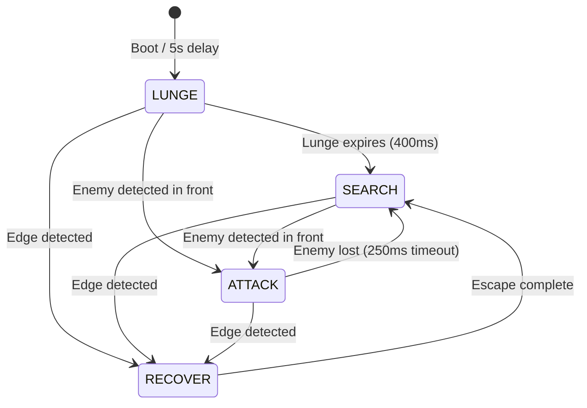

# Autonomous SUMO Robot Controller

An optimized, non-blocking state machine controller for an autonomous differential-drive SUMO robot running on an ESP32, communicating with a Cytron SmartDriveDuo-10 (MDDS10) motor driver over UART.

## Hardware Configuration

- **Controller:** ESP32Dev Module
- **Motor Driver:** Cytron SmartDriveDuo-10 (MDDS10) configured in UART Simplified Serial Mode (19200 baud).
- **Edge Sensors:** 4x Reflectance Sensors (Front Left, Front Right, Back Left, Back Right) mapped to GPIO pins.
- **Enemy Sensors:** 5x Proximity IR/TOF Sensors (Front Left, Front Center, Front Right, Side Left, Side Right) mapped to GPIO pins.

---

## State Machine Architecture

The robot's behavior is governed by a prioritized, non-blocking finite state machine (FSM) comprising four states:

---

## Behavioral Details

### 1. LUNGE State (Match Startup)
To gain a competitive edge, the robot enters the `LUNGE` state immediately after the 5-second competition start delay. 
- **Action:** Drives full speed forward (`255, 255`) for **400ms** toward the opponent's starting position.
- **Interrupts:** If an enemy is detected in front, it immediately transitions to `ATTACK`. If an edge is detected, it overrides the lunge and transitions to `RECOVER`.

### 2. SEARCH State (Spiral Scanning)
If no enemy is visible, the robot enters the `SEARCH` state to locate the opponent.
- **Action (Spiral Pattern):** Instead of spinning in place, the robot drives in a forward-biased spiral to cover actual ground across the arena. 
- **Direction Flip:** Every **1.5 seconds**, the robot reverses its search direction (e.g., left spiral to right spiral) to prevent getting stuck in loops.
- **Side Sensor Overrides:** If `SIDE_LEFT` or `SIDE_RIGHT` detects the opponent, the spiral is overridden to execute a high-speed spin in place directly towards that sensor. If the enemy enters the front view, it transitions to `ATTACK`.

### 3. ATTACK State (Lock & Charge)
Triggered when the opponent is detected by any of the front sensors (`FRONT_LEFT`, `FRONT_CENTER`, `FRONT_RIGHT`).
- **Steering Control:**
  - **Center Sensor Active OR Left + Right Sensors Active:** Charges straight ahead at maximum speed (`255, 255`). This balanced response allows the robot to plow straight into the center of a group of opponents or hit a wide robot dead-center, rather than oscillating or turning away from one of them.
  - **Left Sensor Active (only):** Steers left (`160, 255`) to center the target.
  - **Right Sensor Active (only):** Steers right (`255, 160`) to center the target.
- **Tracking Memory:** If all front sensors lose detection (momentary target dropout), the robot holds the `ATTACK` state and continues charging in the last tracked direction for **250ms**. It will instantly revert to `SEARCH` if the opponent is seen on the side sensors or if the timeout expires.

### 4. RECOVER State (Edge Avoidance)
This state has the **highest priority** and cannot be overridden by combat behaviors.
- **Trigger:** Any of the 4 corner line sensors detecting the white border ring.
- **Non-blocking Execution:**
  - **Phase 1 (150ms):** Drives straight away from the edge (reverses if triggered by front sensors, drives forward if triggered by back sensors).
  - **Phase 2 (200ms):** Spins away from the edge towards the center of the ring (turn direction determined by which corner sensor was triggered).
  - Once Phase 2 is complete, it transitions back to `SEARCH`.

---

## Safety & Reliability Enhancements

1. **Line Sensor Debouncing:** Avoids false recovery triggers caused by electrical noise or arena scratches by requiring a line sensor to remain `LOW` for at least 2 consecutive loops (20ms) before entering `RECOVER`.
2. **Motor Command Throttling:** Caches commanded values and only sends serial packets to the MDDS10 when values change or a 50ms keepalive timer expires, maximizing UART bus availability.
3. **Hardened Startup Sequence:** Explicitly commands the motor driver to stop on boot and right after the 5-second competition delay to prevent runaway states.
4. **Transition Logging:** Prints debug state updates to `Serial` at 115200 baud for convenient field diagnostics.
